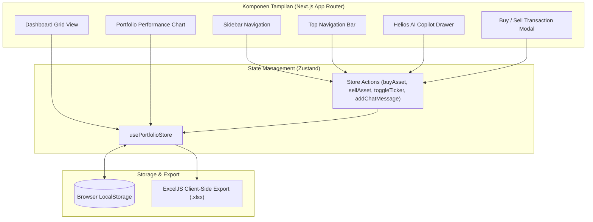

# 03-ARCHITECTURE: Helios Investments System & Component Architecture

Dokumen ini menguraikan struktur direktori, topologi komponen, manajemen state, alur data reaktif, dan strategi ekspor statis untuk **Helios Investments**.

---

## 1. Pola Arsitektur: Client-Side Local-First

Aplikasi ini mengadopsi prinsip **Local-First Architecture**:
- Seluruh state aplikasi dikelola di memori klien menggunakan **Zustand** dengan persistensi otomatis ke `localStorage`.
- Saat pertama kali dibuka tanpa data lokal, sistem secara otomatis melakukan *hydration* menggunakan dataset **Mock Seeds** komprehensif yang identik dengan gambar referensi.
- Tidak ada panggilan API jaringan backend yang dapat menyebabkan kegagalan koneksi; rendering bersifat instan (sub-second performance).



---

## 2. Struktur Direktori Proyek

```text
opencode5/
├── app/
│   ├── layout.tsx                     # Root layout, font loader, metadata SEO
│   ├── page.tsx                       # Halaman Dashboard Utama (Visual Referensi)
│   ├── portfolio/
│   │   └── page.tsx                   # Rincian portofolio & alokasi aset
│   ├── analysis/
│   │   └── page.tsx                   # Metrik Sharpe ratio, volatilitas, risiko
│   ├── market/
│   │   └── page.tsx                   # Screener bursa, top gainers/losers
│   ├── community/
│   │   └── page.tsx                   # Sentimen pasar, feed analis
│   ├── settings/
│   │   └── page.tsx                   # Pengaturan mata uang, tema, live simulator
│   └── globals.css                    # Tailwind CSS v4 setup & custom utilities
├── components/
│   ├── layout/
│   │   ├── app-shell.tsx              # Wrapper layout utama (Sidebar + Main Content)
│   │   ├── sidebar.tsx                # Sidebar navigasi vertikal kiri
│   │   └── top-header.tsx             # Header atas, greeting, tab, AI search bar
│   ├── dashboard/
│   │   ├── total-holding-card.tsx     # Kartu saldo $12,304.11 & dropdown 6M
│   │   ├── ai-decision-banner.tsx     # Kartu Decisions Powered by Data & CTA
│   │   ├── watchlist-card.tsx         # Kartu watchlist saham & tab filter
│   │   ├── portfolio-grid.tsx         # Grid 2x2 posisi saham (AAPL, AMZN, MSFT, NVDA)
│   │   └── performance-chart.tsx      # AreaChart Recharts dengan milestone tooltip
│   ├── ai/
│   │   ├── ai-chat-drawer.tsx         # Drawer asisten AI Helios
│   │   └── ai-insight-card.tsx        # Widget rekomendasi rebalancing
│   ├── modals/
│   │   ├── asset-detail-modal.tsx     # Modal detail posisi dan riwayat harga
│   │   └── transaction-modal.tsx      # Modal formulir order beli/jual
│   └── ui/
│   │   ├── badge.tsx                  # Komponen badge gain/loss
│   │   ├── button.tsx                 # Tombol aksen mauve bergradasi
│   │   ├── dropdown.tsx               # Dropdown filter periode
│   │   ├── modal.tsx                  # Base wrapper modal dengan Framer Motion
│   │   └── toast.tsx                  # Sistem notifikasi toast
├── lib/
│   ├── store.ts                       # Zustand store utama + persistensi LocalStorage
│   ├── seeds.ts                       # Dataset awal Nadia Rachel & data bursa
│   ├── formatters.ts                  # Formatter mata uang ($ USD, Rp IDR), angka, tanggal
│   ├── excel-export.ts                # Helper ExcelJS pembuat berkas .xlsx
│   └── ticker-simulator.ts            # Interval simulasi fluktuasi harga live
├── types/
│   └── index.ts                       # Definisi TypeScript interface & types
├── public/
│   ├── .nojekyll                      # Bypass pemrosesan Jekyll di GitHub Pages
│   └── favicon.ico                    # Favicon aplikasi
├── next.config.ts                     # Konfigurasi Next.js static export
├── tailwind.config.ts                 # Konfigurasi Tailwind & palet mauve
├── tsconfig.json                      # Konfigurasi TypeScript strict mode
├── package.json                       # Konfigurasi dependensi proyek
└── AGENTS.md                          # Aturan kerja agen opencode
```

---

## 3. Alur Data & State Synchronization

1. **Inisialisasi & Hydration:**
   - Saat aplikasi pertama kali dimuat, `usePortfolioStore` memeriksa ketersediaan data di `localStorage`.
   - Jika kosong, store mengisi state dengan `INITIAL_PORTFOLIO_DATA` dari `seeds.ts` (saldo: $12,304.11, posisi: AAPL, AMZN, MSFT, NVDA, watchlist: SPOT, AMZN, MSFT, NVDA).
2. **Perhitungan Valuasi Otomatis:**
   - Setiap kali harga saham berfluktuasi atau terjadi transaksi, getter `totalValuation` menghitung ulang nilai total:
     $$\text{Total Holding} = \text{Cash Balance} + \sum (\text{Units Held}_i \times \text{Current Price}_i)$$
3. **Grafik Recharts Reaktif:**
   - Dataset kurva performa portofolio 1Y dihubungkan langsung ke data histori di store. Hover pada chart menampilkan tooltip kustom dengan titik koordinat presisi.

---

## 4. Strategi Ekspor Statis GitHub Pages

- `next.config.ts` dikonfigurasi dengan:
  ```typescript
  const nextConfig = {
    output: 'export',
    basePath: process.env.NEXT_PUBLIC_BASE_PATH || '',
    images: { unoptimized: true },
    trailingSlash: true,
  };
  export default nextConfig;
  ```
- Ekspor menghasilkan berkas HTML statis murni di folder `out/`.
- File `public/.nojekyll` disalin otomatis ke `out/.nojekyll` untuk mencegah GitHub Pages mengabaikan folder aset internal Next.js `_next/`.
